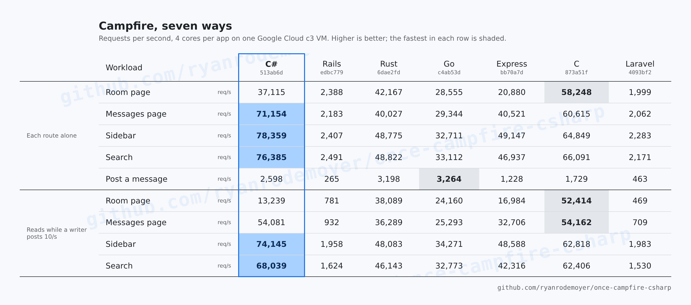

# Every port on one machine

Rails, C# and five other Campfire ports, measured on the shared harness
([basecamp/once-campfire-verification](https://github.com/basecamp/once-campfire-verification)
`ec02deb`, through [`verification/run`](verification/run)) on one cloud VM. Each app gets the same
seed, the same four cores and the same route contracts. The harness runs one app at a time and
alternates the order between rounds.

These are the published numbers for the C# port. They replace every earlier cross-port run.



[`card/render.py`](card/render.py) draws that image from the session 1 result folders below, through
the same functions `verification/summarize.py` uses, so no number in it is typed by hand.

## The machine

A Google Cloud `c3-standard-22-lssd` in `us-central1-a`, with simultaneous multithreading turned
off (`--threads-per-core=1`), so each CPU is a whole core:

- Intel Xeon Platinum 8481C (Sapphire Rapids), 11 cores, 88 GB, Ubuntu 24.04, Docker 29.1.3.
- Docker's data, `/tmp` and the code on the VM's local NVMe SSD, so every SQLite write and fsync
  lands on local storage, not a network disk.
- Each app on cores 7–10, the load generator on 3–6, and the harness's runner on 0–6
  (`APP_CPUS=7-10 CLIENT_CPUS=3-6 RUNNER_CPUS=0-6`).

16 keep-alive clients with gzip, three rounds of eight seconds per route. Each cell is the median of
the three rounds.

## Two sessions, every response checked

Both profiles ran twice from scratch, with fresh containers and fresh copies of the seed. Every
measured response was checked against the harness's route contracts first:

| Run | Validated responses | Errors | Invalid |
|---|---:|---:|---:|
| [Session 1, normal](results/final-s1-normal) | 73,328,538 | 0 | 0 |
| [Session 2, normal](results/final-s2-normal) | 73,532,696 | 0 | 0 |
| [Session 1, mixed](results/final-s1-mixed) | 24,561,185 | 0 | 0 |
| [Session 2, mixed](results/final-s2-mixed) | 24,549,382 | 0 | 0 |

The tables below are session 1. Session 2 agrees within a few percent on every route; its tables are
in each folder's `summary.md`, next to the raw samples, provenance and load log.

## Normal profile

Each route is measured on its own. Requests per second (higher is better):

| Workload | Rails | C# | Rust | Go | Express | Laravel | C |
|---|---:|---:|---:|---:|---:|---:|---:|
| Room page | 2,388 | 37,115 | 42,167 | 28,555 | 20,880 | 1,999 | 58,248 |
| Messages page | 2,183 | 71,154 | 40,027 | 29,344 | 40,521 | 2,062 | 60,615 |
| Sidebar | 2,407 | 78,359 | 48,775 | 32,711 | 49,147 | 2,283 | 64,849 |
| Search | 2,491 | 76,385 | 48,822 | 33,112 | 46,937 | 2,171 | 66,091 |
| Post a message | 265 | 2,598 | 3,198 | 3,264 | 1,228 | 463 | 1,729 |

p99 latency in ms (lower is better):

| Workload | Rails | C# | Rust | Go | Express | Laravel | C |
|---|---:|---:|---:|---:|---:|---:|---:|
| Room page | 17.45 | 2.39 | 0.71 | 2.39 | 3.52 | 16.21 | 0.59 |
| Messages page | 24.57 | 0.39 | 0.75 | 2.33 | 1.01 | 16.09 | 0.58 |
| Sidebar | 19.71 | 0.31 | 0.65 | 2.09 | 0.89 | 14.94 | 0.51 |
| Search | 18.41 | 0.29 | 0.66 | 2.11 | 0.71 | 15.46 | 0.47 |
| Post a message | 158.85 | 12.64 | 14.61 | 18.19 | 65.47 | 83.26 | 17.25 |

Multiple of Rails:

| Workload | C# | Rust | Go | Express | Laravel | C |
|---|---:|---:|---:|---:|---:|---:|
| Room page | 15.5× | 17.7× | 12.0× | 8.7× | 0.8× | 24.4× |
| Messages page | 32.6× | 18.3× | 13.4× | 18.6× | 0.9× | 27.8× |
| Sidebar | 32.6× | 20.3× | 13.6× | 20.4× | 0.9× | 26.9× |
| Search | 30.7× | 19.6× | 13.3× | 18.8× | 0.9× | 26.5× |
| Post a message | 9.8× | 12.1× | 12.3× | 4.6× | 1.7× | 6.5× |

## Mixed-write profile

The four pages are read by 16 clients while one writer posts at most 10 messages a second to
another room, which keeps emptying the response caches. Requests per second:

| Workload | Rails | C# | Rust | Go | Express | Laravel | C |
|---|---:|---:|---:|---:|---:|---:|---:|
| Room page | 781 | 13,239 | 38,089 | 24,160 | 16,984 | 469 | 52,414 |
| Messages page | 932 | 54,081 | 36,289 | 25,293 | 32,706 | 709 | 54,162 |
| Sidebar | 1,958 | 74,145 | 48,083 | 34,271 | 48,588 | 1,983 | 62,818 |
| Search | 1,624 | 68,039 | 46,143 | 32,773 | 42,316 | 1,530 | 62,406 |

p99 latency in ms:

| Workload | Rails | C# | Rust | Go | Express | Laravel | C |
|---|---:|---:|---:|---:|---:|---:|---:|
| Room page | 278.53 | 9.17 | 0.81 | 3.86 | 7.95 | 167.17 | 0.69 |
| Messages page | 210.05 | 2.27 | 0.86 | 3.42 | 2.96 | 111.55 | 0.69 |
| Sidebar | 35.84 | 0.41 | 0.70 | 2.01 | 1.09 | 19.74 | 0.55 |
| Search | 63.23 | 0.62 | 0.73 | 2.26 | 0.94 | 44.19 | 0.54 |

## What was measured

| App | Commit | How it serves HTTP |
|---|---|---|
| Rails | `edbc779` (this repo's `reference/`) | Thruster in front of Puma: 3 workers, 5 threads |
| C# | `513ab6d` (`main`) | Kestrel alone (`CAMPFIRE_THRUSTER=0`), 5 readers |
| Rust | `6dae2fd` | in-process front, 5 readers |
| Go | `c4ab53d` | in-process front |
| Express | `bb70a7d` | cluster, workers from the cpuset |
| Laravel | `4093bf2` | FrankenPHP/Octane |
| C | `873a51f` | in-process, one event loop per allowed CPU (4 here) |

The other ports are each upstream repository's latest commit as of 2026-10-14, pinned in
[`verification/ports.tsv`](verification/ports.tsv) and built by `verification/run ports`.

- **C# runs without Thruster here.** The other ports serve HTTP from their own process, so C# was
  measured the same way. As shipped, the C# image runs Thruster for TLS and certificates, like Rails.
- **Rails runs behind Thruster,** as it ships. Part of every port's lead over Rails is that proxy hop.
- **Django and Elixir are left out.** Django ran with one worker under this harness, which isn't a
  fair picture of it. Elixir's image doesn't build: its Dockerfile pins a Debian package version
  that Debian has since replaced.
- **Spreads.** Most routes varied 1–4% between rounds. C#'s room page varied more (12.5% normal,
  33% under writes), as did Express's sidebar (26% normal). The medians are what the tables show, and
  every round is in the raw samples.
- **It's one machine.** The ratios mean more than the absolute numbers; another CPU will move every
  column.

## Reproduce

On a Linux host with Docker, Rust and Python 3, as a user with UID 1000 (the app images run as UID
1000 and must be able to write the seed copies the harness makes):

```sh
bench/verification/run prepare
export APPS=rails,csharp,rust,go,express,laravel,c
bench/verification/run ports
docker build -t campfire-csharp:final .           # from the C# commit being measured
export CSHARP_IMAGE=campfire-csharp:final CSHARP_BENCH_ENV='{"CAMPFIRE_THRUSTER":"0"}'
export APP_CPUS=7-10 CLIENT_CPUS=3-6 RUNNER_CPUS=0-6   # match your machine
bench/verification/run bench normal "$PWD/bench/results/final-s1-normal"
bench/verification/run bench mixed "$PWD/bench/results/final-s1-mixed"
python3 bench/verification/summarize.py bench/results/final-s1-normal
```

Each normal run took about 33 minutes and each mixed run about 19.
